<div align="center">

# Toolkit GTI

**Central de suporte técnico para estações Windows, direto na rede local**

Diagnóstico, manutenção, presença na rede e chat com o usuário num único app nativo,
sem servidor central e sem internet.


</div>

---

## Sumário

1. [Visão geral](#1-visão-geral)
2. [Funcionalidades](#2-funcionalidades)
3. [Arquitetura](#3-arquitetura)
4. [Ciclo de vida do app](#4-ciclo-de-vida-do-app)
5. [Login e sessão do técnico](#5-login-e-sessão-do-técnico)
6. [Atendimento por chat](#6-atendimento-por-chat)
7. [Pop-up e resposta do usuário](#7-pop-up-e-resposta-do-usuário)
8. [Usuários Online: presença na rede](#8-usuários-online-presença-na-rede)
9. [Protocolo da LAN e assinatura HMAC](#9-protocolo-da-lan-e-assinatura-hmac)
10. [Segurança](#10-segurança)
11. [Arquivos gravados em disco](#11-arquivos-gravados-em-disco)
12. [Configuração](#12-configuração)
13. [Instalação em produção](#13-instalação-em-produção)
14. [Desenvolvimento e testes](#14-desenvolvimento-e-testes)
15. [Solução de problemas](#15-solução-de-problemas)
16. [Identidade visual](#16-identidade-visual)

---

## 1. Visão geral

O Toolkit GTI é instalado em **todas** as estações da rede. Cada cópia sobe um pequeno
servidor HTTP/WebSocket na porta `7890`, e as cópias conversam entre si pela LAN. Não
existe servidor central: o PC do técnico fala direto com o PC do usuário.

O mesmo executável assume um de dois papéis:

| Papel | Como entra | O que vê |
|---|---|---|
| **Técnico** | Abre o app e faz login com conta do AD que pertence ao grupo de técnicos (`TOOLKIT_ADMIN_GROUP`) | Painel completo: diagnóstico, ferramentas, chamados, varredura da rede e chat |
| **Usuário final** | O app sobe sozinho no logon do Windows, oculto, sem pedir login | Só o ícone na bandeja. Recebe convites de chat e pop-ups do técnico. Se abrir o painel, vê "Área restrita à equipe GTI" |

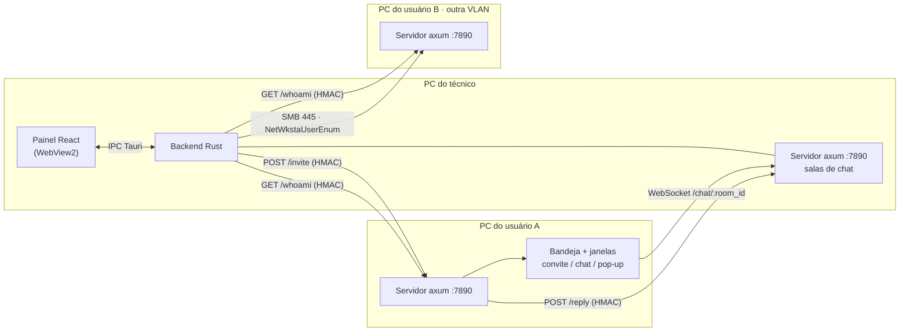

---

## 2. Funcionalidades

O painel do técnico tem oito abas, todas no menu lateral (recolhível para mostrar só ícones).

| Aba | Para que serve |
|---|---|
| **Resumo do Sistema** | Saúde da estação em tempo real: CPU, RAM, discos e rede; hostname, número de série, IPs; firewall, antivírus, BitLocker e Windows Update. Um alerta no topo resume o que precisa de atenção (CPU alta, pouca RAM, disco cheio, firewall desligado) |
| **Ambiente Web** | Versões instaladas de Chrome, Edge e Firefox, lidas do registro e dos executáveis |
| **Histórico** | Log de auditoria das ações técnicas. Exporta para arquivo pelo "Salvar como" nativo do Windows |
| **Ferramentas** | Ping (inclusive contínuo, `-t`), teste de portas, DNS, `netstat`, `ipconfig`, GPUpdate, DISM, SFC, reset de Winsock, reinício do spooler, limpeza de temporários, ponto de restauração e atalhos do Windows. A saída aparece em tempo real num terminal modal |
| **Chamados** | Escolhe uma máquina e: chama o usuário para o chat, envia um pop-up de aviso ou abre a Assistência Remota do Windows (`msra /offerra`) |
| **Usuários Online** | Varre a rede e lista quem está ligado e logado, onde e há quanto tempo. Busca uma pessoa pelo login. Conecta direto por IP ou nome de máquina |
| **Chat** | Conversa com um ou vários usuários ao mesmo tempo, em abas: texto, arquivos até 10 MB, "digitando…", recibos de enviado/entregue/lido |
| **Configurações** | Porta do chat (padrão `7890`), faixas de rede extras para a varredura e informações do app |

Recursos transversais:

- **Modo bandeja:** fechar a janela principal não encerra o app. Ele continua na bandeja, com
  baixo consumo de memória, pronto para receber convites.
- **Notificações nativas:** mensagens novas geram toast do Windows com identidade própria
  (AUMID `com.gti.toolkit`), sem janela de console.
- **Alertas de runtime:** falhas no startup (servidor do chat, regra de firewall, named pipe)
  ficam guardadas e aparecem num banner no topo do painel, mesmo que tenham ocorrido antes de
  a janela abrir.
- **Elevação sob demanda:** o app roda sem privilégio de administrador. Ferramentas que exigem
  admin oferecem "Abrir como administrador", que reabre o app pelo UAC.

---

## 3. Arquitetura

### 3.1 Stack

| Camada | Tecnologia |
|---|---|
| Shell desktop | Tauri 2: WebView2, bandeja, notificações, diálogos nativos |
| Backend | Rust + Tokio · `axum` (HTTP/WebSocket) · `sysinfo` · `windows` / `winreg` / `winping` · `reqwest` com `rustls` · `hmac` / `sha2` |
| Frontend | React 18 + TypeScript 5 · Vite 6 · Tailwind 3 com tokens semânticos · `motion` · ícones `lucide-react` |
| Testes | Vitest + Testing Library · Playwright com IPC simulado · testes de integração Rust |
| Instalador | MSI (WiX) com fragmento próprio para início automático e firewall |

### 3.2 Camadas

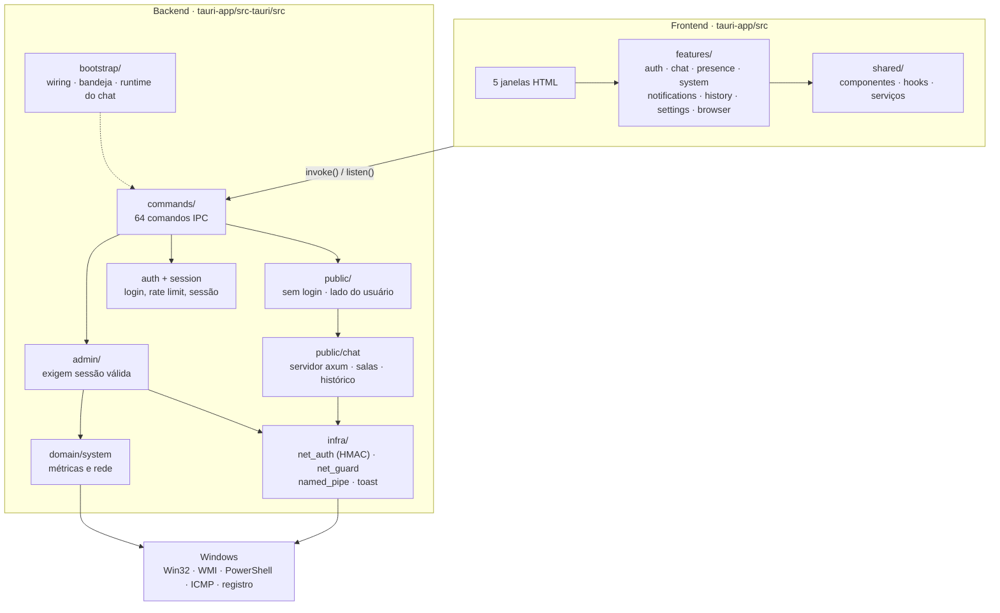

### 3.3 Janelas

Cada janela é uma entrada HTML separada, com permissões (*capabilities*) mínimas próprias.

| Janela | Arquivo | Onde aparece | Quando |
|---|---|---|---|
| Principal | `index.html` | Técnico (e usuário, restrita) | Ao abrir o app ou pelo menu da bandeja |
| Convite | `chat-invite.html` | PC do usuário | Quando chega um convite válido de atendimento |
| Chat do usuário | `user-chat.html` | PC do usuário | Depois que o usuário aceita o convite |
| Pop-up | `popup-notification.html` | PC do usuário | Quando o técnico envia um aviso |
| Resposta | `popup-reply.html` | PC do técnico | Quando o usuário responde a um aviso ou convite |

### 3.4 Estrutura de pastas

```text
tauri-app/
├── index.html, user-chat.html, chat-invite.html,
│   popup-notification.html, popup-reply.html     entradas das janelas
├── src/
│   ├── app/            shell, roteamento por abas, modo bandeja, banners
│   ├── features/
│   │   ├── auth/           login, detecção da conta Windows, sessão
│   │   ├── browser/        versões de navegadores
│   │   ├── chat/           chat do técnico e do usuário, protocolo, histórico
│   │   ├── history/        log de auditoria e exportação
│   │   ├── notifications/  chamados, pop-ups, assistência remota
│   │   ├── presence/       usuários online, busca por login, conexão por IP/host
│   │   ├── settings/       porta do chat, faixas de rede
│   │   └── system/         resumo do sistema e ferramentas
│   ├── shared/         componentes (Sidebar, ModalShell, Switch…), hooks, serviços
│   └── styles/         globals.css com tokens e utilitários
├── src-tauri/
│   ├── src/
│   │   ├── bootstrap/      montagem do app, bandeja, runtime do chat
│   │   ├── commands/
│   │   │   ├── auth*.rs, session.rs   login, rate limit, sessão
│   │   │   ├── admin/                 comandos do técnico
│   │   │   │   └── presence/          varredura, busca, sondagem, SMB, cache
│   │   │   └── public/                comandos sem login
│   │   │       └── chat/              servidor axum, salas, armazenamento
│   │   ├── domain/system/  coleta de métricas e dados de rede
│   │   ├── events/         alertas de runtime e janela do chat
│   │   ├── infra/          HMAC, validação de host, named pipe, toast
│   │   └── session/        estado da sessão e limpeza periódica
│   ├── capabilities/   permissões por janela
│   ├── wix/            fragmento do MSI (autostart + firewall)
│   ├── icons/          ícones do app
│   └── tests/          testes de integração Rust
└── tests/e2e/          Playwright com mock do IPC
scripts/firewall/       criação manual da regra de firewall
```

---

## 4. Ciclo de vida do app

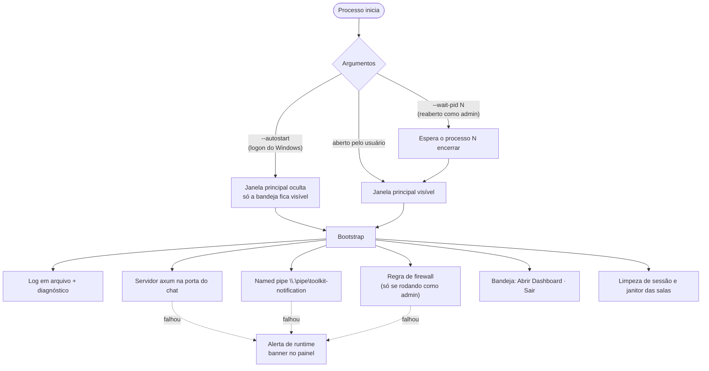

- **Início automático:** o MSI grava em `HKLM\Software\Microsoft\Windows\CurrentVersion\Run`
  o executável com `--autostart`, para todos os usuários. Nesse modo a janela principal fica
  oculta e o usuário só vê a bandeja.
- **Bandeja:** "Abrir Dashboard" mostra a janela principal; "Sair" encerra o processo. Fechar
  a janela pelo X apenas a esconde.
- **Elevação:** o manifest pede `asInvoker`, então o app nunca exige admin para subir. Quando
  o técnico precisa de uma ferramenta administrativa, `relaunch_as_admin` abre uma nova cópia
  pelo UAC com `--wait-pid <pid atual>`. A cópia nova espera a antiga sair, porque a porta do
  chat, o named pipe e a instância única só aceitam um dono. Se o UAC for cancelado, a cópia
  atual continua como estava.
- **Sem segredo da LAN configurado:** o chat sobe com o segredo padrão. Se o subsistema de chat
  não conseguir subir, o app continua aberto e emite `chat-unavailable` para a interface.

---

## 5. Login e sessão do técnico

A tela de login detecta a conta do Windows logada e só pede a senha. O backend aceita apenas o
`sAMAccountName` (o prefixo `DOMINIO\` é removido no frontend).

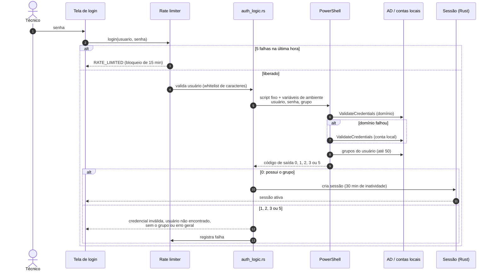

| Código do script | Significado | Mensagem |
|---|---|---|
| `0` | Credencial válida e usuário no grupo exigido | Login autorizado |
| `1` | Senha inválida no domínio e na conta local | Credenciais inválidas |
| `2` | Usuário não encontrado | Usuário não encontrado no AD/local |
| `3` | Autenticou, mas não pertence ao grupo | Usuário autenticado, mas não possui o grupo |
| `5` | Exceção no script | Erro na autenticação |

Regras da sessão:

- A sessão vive no Rust, não no frontend. Expira após **30 minutos sem atividade** e uma
  rotina limpa sessões vencidas a cada **60 s**.
- Todo comando de `admin/` chama `require_valid_session` antes de executar.
- O bloqueio de força bruta persiste em `%LOCALAPPDATA%\ToolkitGTI\rate_limit.json`, então
  reiniciar o app não zera as tentativas.
- Em **build debug** o login aceita `admin`/`admin` para testes locais. Em release esse
  caminho nem é compilado.

---

## 6. Atendimento por chat

### 6.1 Do clique em "Chamar" à conversa

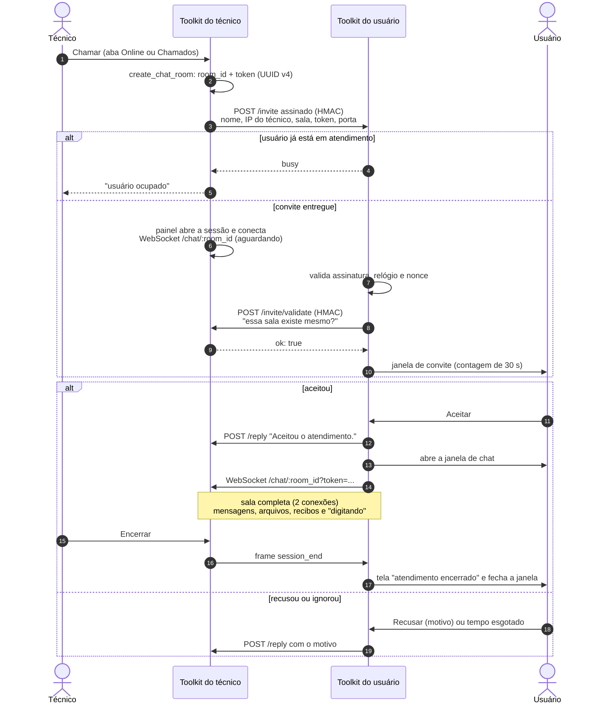

Detalhes importantes do fluxo:

- **IP do técnico no convite:** o backend usa o IP de origem da rota até o usuário
  (`local_ip_toward`). Assim o convite funciona também por VPN *split-tunnel*, em que a rota
  padrão sai por outra interface.
- **Confirmação com a origem:** o PC do usuário só mostra o convite depois de confirmar a sala
  com a máquina que o enviou. Essa confirmação só pode ir para um IP de LAN. Um convite forjado
  por terceiros não abre janela.
- **As salas moram no PC do técnico.** O usuário conecta no servidor axum do técnico.

### 6.2 Ciclo de vida da sala

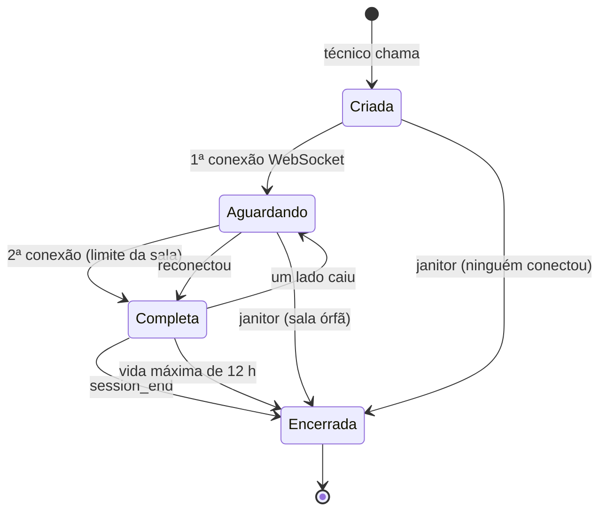

| Regra da sala | Valor |
|---|---|
| Identificação | `room_id` + `token`, ambos UUID v4 |
| Conexões simultâneas | no máximo 2 |
| Vida máxima | 12 horas |
| Janitor (limpeza de salas órfãs) | a cada 30 s |

### 6.3 Frames trocados no WebSocket

O servidor faz *relay* dos frames JSON entre os dois lados. Cada frame tem `msg_type`.

| `msg_type` | `sender` | Campos principais | Uso |
|---|---|---|---|
| `text` | `me` | `content`, `msg_id`, `timestamp` | Mensagem de texto (até 2000 caracteres) |
| `file` | `me` | `filename`, `mime_type`, `file_data`, `msg_id` | Arquivo em base64 (até 10 MB; o WebSocket aceita até 14 MB por frame) |
| `receipt` | `system` | `state` (`delivered` / `read`), `msg_id` ou `msg_ids` | Recibos de entrega e leitura |
| `typing` | `system` | `role`, `state` (`start` / `stop`) | Indicador de "digitando…" |
| `presence` | `system` | `role`, `presence` (`active` / `away` / `offline`) | Se o outro lado está com a janela em foco, ausente ou fora |
| `client_identity` | `system` | `display_name` | Identifica o usuário para o painel do técnico |
| `session_end` | `system` | `role` | Técnico encerrou o atendimento |

Status de cada mensagem enviada: `sending` → `sent` → `delivered` → `read` (ou `failed`, com
botão de reenviar).

### 6.4 Janela de chat do usuário

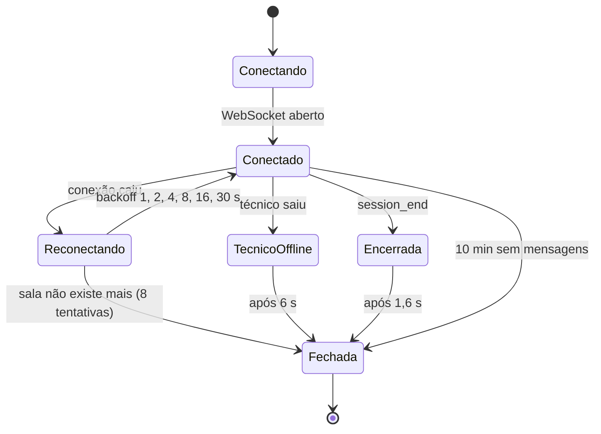

- O botão de ocultar **minimiza** para a barra de tarefas (nunca esconde), para o usuário
  conseguir voltar sozinho.
- Mensagem nova com a janela fora de foco gera toast do Windows e altera o título da janela.
- Ao reabrir um atendimento, a janela existente é reaproveitada e navega para a nova sala.

### 6.5 Histórico

Cada lado grava o histórico em `%USERPROFILE%\Documents\Toolkit_GTI\chat_<id>.json`, em que
`<id>` é o `room_id` ou o IP (com `.` e `:` trocados por `_`). O id passa por whitelist antes
de virar nome de arquivo (anti *path traversal*).

---

## 7. Pop-up e resposta do usuário

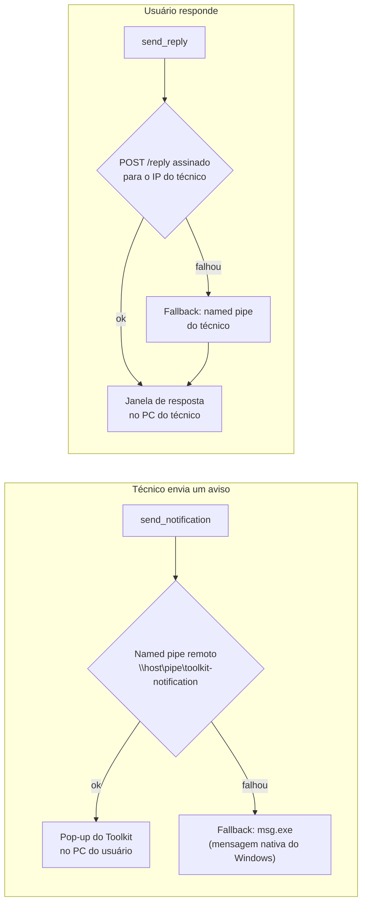

- `send_reply` roda no PC do usuário, que nunca faz login. Por isso ele mesmo valida o destino:
  IP só de LAN e host no charset de hostname, antes de montar o caminho UNC do pipe.
- Convites de chat que cheguem pelo named pipe são **ignorados**. Convite só entra por
  `POST /invite` assinado e confirmado com a origem.

---

## 8. Usuários Online: presença na rede

A presença é descoberta **sob demanda**: cada clique em "Atualizar" (ou o auto-atualizar)
dispara uma varredura. Não há heartbeat entre as máquinas.

### 8.1 Plano de varredura

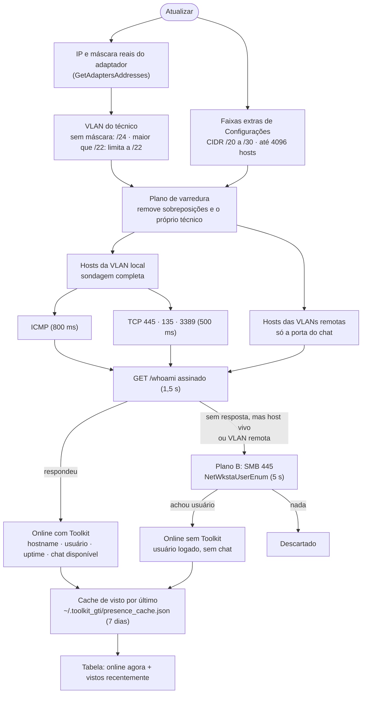

| Parâmetro | Valor |
|---|---|
| Sondagens simultâneas | até 256 |
| Timeout ICMP | 800 ms |
| Timeout TCP (445, 135, 3389) | 500 ms |
| Timeout do `/whoami` | 1,5 s |
| Timeout do SMB (`NetWkstaUserEnum`) | 5 s |
| Prefixos aceitos nas faixas extras | `/20` a `/30` |
| Total de hosts extras | até 4096 |
| Validade do cache de visto por último | 7 dias |

Por que SMB como plano B: entre VLANs ou unidades, a porta `445` costuma passar onde a `7890`
(chat) e a `135` (WMI/DCOM) são bloqueadas. `NetWkstaUserEnum` responde em dezenas de
milissegundos e exige que o técnico seja admin local no alvo, o que o grupo de técnicos já
garante. A linha aparece como "sem toolkit": dá para ver quem está logado, mas não para abrir
chat.

### 8.2 Busca de uma pessoa pelo login

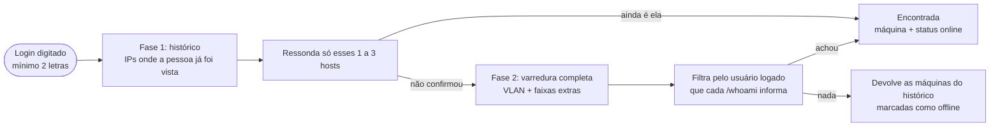

O casamento ignora domínio e caixa (`EMPRESA\Joao.Silva` = `joao.silva`). Resultado exato vem
antes de parcial (`joao` acha `joao.silva`).

### 8.3 Conectar por IP ou host

O campo "Conectar por IP ou host" aceita um IPv4 ou um nome de máquina. O nome é resolvido no
DNS (timeout de 3 s) e o endereço passa pela mesma sondagem (ping, TCP, `/whoami`, SMB). Serve
para máquinas fora das faixas configuradas, como um usuário conectado por VPN.

---

## 9. Protocolo da LAN e assinatura HMAC

### 9.1 Endpoints de cada estação

| Método | Rota | Chamado por | Função |
|---|---|---|---|
| `POST` | `/invite` | Técnico → usuário | Entrega o convite de atendimento |
| `POST` | `/invite/validate` | Usuário → técnico | Confirma que a sala do convite existe |
| `POST` | `/reply` | Usuário → técnico | Resposta ao convite ou ao pop-up |
| `GET` | `/whoami` | Técnico → qualquer estação | Hostname, usuário logado e uptime (presença) |
| `GET` (upgrade) | `/chat/:room_id?token=…` | Técnico e usuário | WebSocket da sala |

### 9.2 Assinatura

Toda requisição HTTP da LAN leva três cabeçalhos: `x-toolkit-ts`, `x-toolkit-nonce` e
`x-toolkit-sig`.

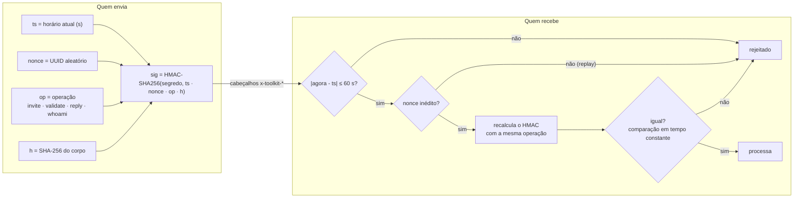

- O **segredo nunca trafega**. Só a assinatura derivada dele.
- A operação entra na assinatura: uma assinatura válida de `/whoami` não serve para `/invite`.
- O segredo vem de `TOOLKIT_GTI_SECRET`. Sem a variável, todas as cópias usam um valor padrão
  que está no código (ver [Limitações](#103-limitações-conhecidas)).

---

## 10. Segurança

### 10.1 Controles por área

| Área | Controle |
|---|---|
| **Execução** | Manifest `asInvoker`: o app nunca exige admin para subir. Ferramentas administrativas pedem para reabrir pelo UAC |
| **Login** | Validação no AD (`PrincipalContext` Domain) ou em conta local. Exige o grupo de `TOOLKIT_ADMIN_GROUP`. Usuário, senha e grupo chegam ao PowerShell por variável de ambiente, nunca interpolados no script |
| **Usuário** | Whitelist de caracteres (`[A-Za-z0-9._-]`, até 64) antes de qualquer uso |
| **Diagnóstico de login** | Desligado por padrão. Quando ligado, linhas com senha, token ou credencial são redigidas |
| **Força bruta** | 5 tentativas por hora, bloqueio de 15 minutos, estado persistido em disco |
| **Sessão** | Mantida no Rust, 30 min de inatividade, limpeza a cada 60 s, checada em todo comando de admin |
| **Injeção de comando** | Destinos de ping, DNS, portas e manutenção passam por whitelist (`[A-Za-z0-9.-_:]`, até 255) antes de virar argumento de processo |
| **LAN: autenticidade** | HMAC-SHA256 em todas as requisições, segredo nunca trafega, comparação em tempo constante |
| **LAN: replay** | Janela de 60 s + cache de nonce de uso único + operação dentro da assinatura |
| **LAN: phishing e SSRF** | Convite só abre depois de confirmado com a origem, e a confirmação só vai para IP de LAN |
| **Salas** | `room_id` + `token` UUID v4, máximo 2 conexões, vida de 12 h, janitor de 30 s |
| **Entrada do chat** | Nome até 64, host até 255, mensagem até 2000 caracteres, arquivo até 10 MB |
| **Arquivos recebidos** | Nome sanitizado: rejeita caminho absoluto, subpastas e `..` |
| **Conteúdo** | Filtro de linguagem ofensiva no chat e validação de tipo e tamanho de upload |
| **WebView** | CSP restrita a `'self'` (mais `ws:`/`wss:` para o chat) e capabilities mínimas por janela |
| **TLS de saída** | `reqwest` com `rustls`, sem OpenSSL |
| **Logs** | Rótulos vindos da rede passam por allowlist e truncamento antes de ir para o log de auditoria |

### 10.2 Fronteiras de confiança

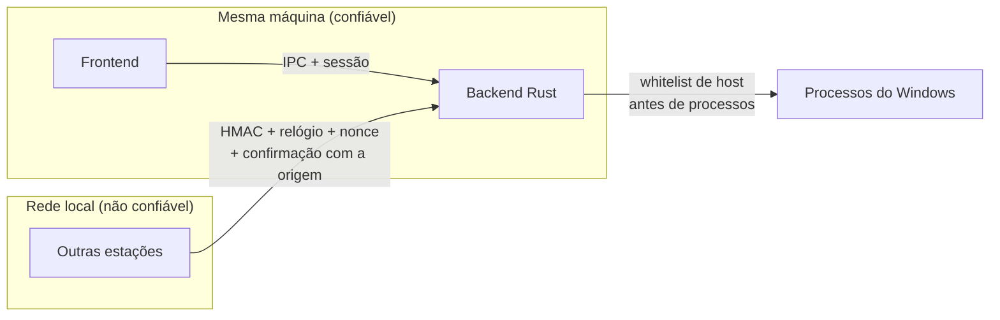

### 10.3 Limitações conhecidas

- **Segredo padrão público.** Sem `TOOLKIT_GTI_SECRET`, o HMAC usa um valor fixo do código. O
  chat funciona sem configuração, mas quem ler o código consegue forjar requisições. Para
  endurecer, provisione a variável com o **mesmo valor em todas as máquinas** (GPO ou MSI).
  Não troque o valor só em parte das máquinas: elas param de se entender.
- **Chat em `ws://`.** O conteúdo trafega sem TLS dentro da LAN e o token da sala vai na URL.
- **Comandos `public/`** (ex.: informações do sistema) não exigem sessão nem têm rate limit.
- **Presença por varredura.** Uma máquina desligada pode aparecer como vista recentemente até
  a próxima varredura.

---

## 11. Arquivos gravados em disco

| Caminho | Conteúdo |
|---|---|
| `%LOCALAPPDATA%\ToolkitGTI\logs\toolkit.log` | Log de diagnóstico, com rotação em 5 MB para `toolkit.log.1` |
| `%LOCALAPPDATA%\ToolkitGTI\rate_limit.json` | Tentativas de login e bloqueios |
| `%USERPROFILE%\Documents\Toolkit_GTI\chat_<id>.json` | Histórico de cada conversa |
| `%USERPROFILE%\.toolkit_gti\presence_cache.json` | Cache de "visto por último" da presença |
| `%USERPROFILE%\.toolkit_gti\presence_networks.json` | Faixas extras de varredura |
| `HKCU\Software\Classes\AppUserModelId\com.gti.toolkit` | Registro do AUMID para as notificações |
| `HKLM\...\CurrentVersion\Run` (valor `ToolkitGTI`) | Início automático, gravado pelo MSI |

---

## 12. Configuração

### 12.1 Variáveis de ambiente

| Variável | Padrão | Efeito |
|---|---|---|
| `TOOLKIT_GTI_SECRET` | segredo público do código | Chave do HMAC da LAN. Precisa ser igual em todas as máquinas |
| `TOOLKIT_ADMIN_GROUP` | `GRP_TOOLKIT_ADMINS` | Grupo do AD (ou local) que libera o login do técnico. Vazio ou acima de 256 caracteres cai no padrão |
| `TOOLKIT_AUTH_DEBUG_INFO` | desligado | `1` devolve o diagnóstico do login, já redigido |
| `TOOLKIT_ALLOW_DEV_AUTH_BYPASS` | desligado | Só tem efeito em build debug |

### 12.2 Pelo painel (Configurações)

- **Porta do chat:** padrão `7890`. Todas as máquinas precisam usar a mesma porta. Porta
  diferente da padrão exige regra de firewall própria (o app recria a regra se estiver rodando
  como admin).
- **Faixas de rede extras:** uma por linha, em CIDR (ex.: `10.20.31.0/24`). A VLAN do próprio
  técnico já é varrida automaticamente. Nas faixas remotas, a porta do chat (ou a 445) precisa
  estar liberada entre as VLANs nos dois sentidos.

---

## 13. Instalação em produção

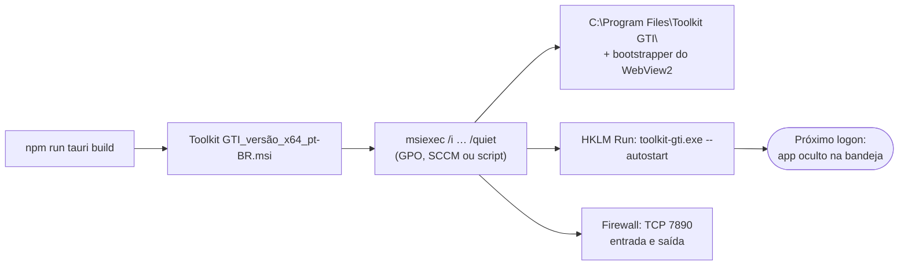

```cmd
:: instalação interativa
"Toolkit GTI_1.3.10_x64_pt-BR.msi"

:: instalação silenciosa
msiexec /i "Toolkit GTI_1.3.10_x64_pt-BR.msi" /quiet /norestart

:: silenciosa com log do instalador
msiexec /i "Toolkit GTI_1.3.10_x64_pt-BR.msi" /quiet /norestart /l*v "%TEMP%\toolkit-install.log"
```

Depois de instalar:

1. Defina `TOOLKIT_ADMIN_GROUP` nas estações dos técnicos com o nome do grupo do AD.
2. Opcional, mas recomendado: defina `TOOLKIT_GTI_SECRET` com o mesmo valor em todas as
   máquinas.
3. Se o firewall da estação for gerenciado por GPO e bloquear a regra local, use os scripts de
   `scripts/firewall/` (`CONFIGURAR-FIREWALL.bat` ou `Add-FirewallRule.ps1`) como administrador.

> **Atualizações:** técnico e usuário precisam falar o mesmo protocolo. Uma mudança no backend
> Rust exige o MSI novo em **todas** as máquinas. Versões novas sempre sobem o número de versão,
> e o MSI atualiza a instalação anterior no lugar.

---

## 14. Desenvolvimento e testes

### 14.1 Requisitos

- Windows 10 ou 11, x64
- Node.js 20+ e npm
- Rust estável ([rustup](https://rustup.rs)) e Visual Studio Build Tools com o workload
  "Desenvolvimento para desktop com C++"
- WebView2 (já vem no Windows 11)

### 14.2 Rodar

Todos os comandos de Node rodam dentro de `tauri-app/`.

```bash
cd tauri-app
npm install
npm run tauri dev      # app completo; o Vite sobe na porta 1427
```

Em build debug, o login aceita `admin` / `admin`.

### 14.3 Build

```bash
npm run build          # tsc + vite build (frontend)
npm run tauri build    # MSI em src-tauri/target/release/bundle/msi/
```

### 14.4 Testes

```bash
npm run test:ci        # Vitest: unitários e componentes
npm run test:coverage  # com piso de cobertura definido em vitest.config.ts
npm run test:e2e       # Playwright

cd src-tauri
cargo test
cargo clippy --lib --bins -- -D warnings
cargo fmt --check
```

| Suíte | O que cobre |
|---|---|
| Vitest | Hooks, serviços, protocolo do chat, timeline, presença, componentes |
| Playwright | Fluxos reais no navegador com o IPC do Tauri simulado (`tests/e2e/utils/tauriMock.ts`): login, ferramentas de rede, Usuários Online, janela principal |
| `cargo test` (integração) | Login e diagnóstico, HMAC da LAN, validação de host, regras de presença, sessão, saída de console |

Os módulos de segurança (`net_guard`, `net_auth`) e as regras de presença são puros e entram
nos testes via `#[path]`. Assim rodam sem linkar o lib do Tauri, que não carrega como binário
de teste no Windows.

### 14.5 Convenções

- TypeScript e Rust sem `any` ou equivalentes.
- Comandos de técnico ficam em `commands/admin/` e sempre validam a sessão.
- Todo dado que vira argumento de processo ou caminho passa por whitelist em `infra/net_guard.rs`.
- Cores só pelos tokens do `tailwind.config.js`; nunca valores soltos nos componentes.

---

## 15. Solução de problemas

| Sintoma | Causa provável | Como verificar |
|---|---|---|
| "Não foi possível entregar o convite" | Toolkit fechado no destino, porta `7890` bloqueada ou IP desatualizado (VPN) | `Test-NetConnection <ip> -Port 7890`; no destino, `Get-NetTCPConnection -LocalPort 7890 -State Listen` |
| Máquina aparece "sem toolkit" | A `7890` não passa, mas a `445` sim | Liberar a porta do chat entre as VLANs ou abrir o Toolkit no destino |
| Usuário não aparece na varredura | VLAN fora das faixas configuradas ou `445`/`7890` bloqueadas | Conferir as faixas em Configurações; testar `Test-NetConnection <ip> -Port 445` |
| Login: "não possui o grupo" | `TOOLKIT_ADMIN_GROUP` ausente ou com outro nome; usuário com mais de 50 grupos | `whoami /groups` e o valor da variável |
| Login bloqueado | 5 falhas na última hora | Esperar 15 min |
| Banner "chat indisponível" | Servidor do chat não subiu (porta ocupada ou segredo inválido) | `%LOCALAPPDATA%\ToolkitGTI\logs\toolkit.log` |
| Convites param de chegar depois de configurar o segredo | `TOOLKIT_GTI_SECRET` diferente entre as máquinas | Comparar o valor da variável nos dois lados |
| Ferramenta pede administrador | DISM, SFC, serviços e firewall exigem elevação | Usar "Abrir como administrador" |

O log de cada estação (`%LOCALAPPDATA%\ToolkitGTI\logs\toolkit.log`) registra o startup
completo, as regras de firewall, cada convite enviado ou recebido e os erros de WebSocket.

---

## 16. Identidade visual

Tema claro **verde-azulado**: destaque `#0f766e`, escuro `#134e4a`, fundo `#f4f8f7`. Títulos
em **Fraunces** e interface em **DM Sans**, as duas empacotadas offline.

As cores são tokens semânticos no `tailwind.config.js` (`base`, `surface`, `line`, `ink`,
`accent`, `success`, `warning`, `danger`). Todos os pares de texto atingem contraste WCAG AA
(≥ 4,5:1). O ícone do app é o "toolbox" do [IconMCP](https://iconmcp.com) (licença MIT).

---

<div align="center">
<sub>Uso interno · equipe GTI</sub>
</div>
